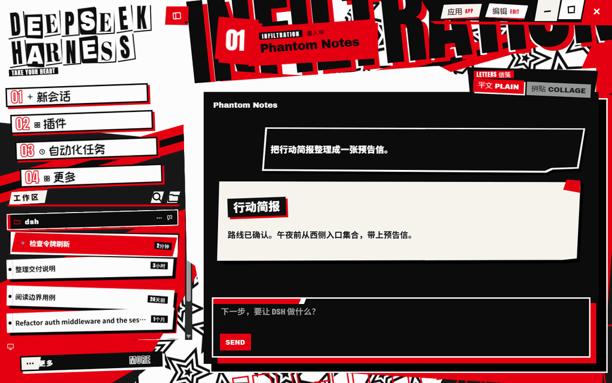

# Persona 5-like Skin for DeepSeek Harness

Calling-card skin for the DeepSeek Harness **web** client. One red / black / white palette, a two-line paper-cut **DEEPSEEK / HARNESS** mark, stepped session rows, black prompt slips, and collage response sheets. It is a separate installable bundle. It does not replace DeepSeek Harness, `dsh-industrial-acid-skin`, or `dsh-audio-reactive`.

中文说明见 [README.zh.md](README.zh.md). Compatibility evidence is in [docs/COMPATIBILITY.md](docs/COMPATIBILITY.md).



The demo shows the diagonal navigation, cut-in transitions, collage letters, pop-up menu, and collapsible sidebar with sample sessions.

[Download the 1.0.1 plugin](https://github.com/yasneg616/persona5-like-deepseek-harness-skin/releases/tag/v1.0.1). The tarball includes the compiled plugin, styles, and fonts. Install it as `dsh-calling-card-skin` in a compatible Harness Web profile.

## What it actually changes

| Seam | Used |
| --- | --- |
| `ctx.theme.overrideTokens` | Yes. Both `light` and `dark` carry the same value, so the host Appearance control does not grow a second theme and this plugin does not write that setting. |
| Plugin stylesheet | Yes. One `<style data-plugin="dsh-calling-card-skin">` removed when the bundle unloads. Rules sit under `html[data-dsh-calling-card-skin]`. |
| `shell.overlay` | Yes. Architectural type, paper-cut, the letters switch, the desktop caption cluster and the collapsed-rail tickets. The overlay root is click-through. |
| `sidebar.brand.mark` / `sidebar.brand.name` | Yes, at priority `-1`, released on unload. |
| `root`, `sidebar`, `main`, `rightbar` | Not registered. ui-renderer documents that replacing `root` removes the frame and every seat inside it. |

The page ground is the v9 sheet: a white diagonal, a red fault, and one diagonal band of large nested stars (`assets/star-field.svg`). The giant word is `clamp(96px, 11vw, 168px)`, rotated, and painted behind the columns so the caps stay readable and the nav meets the baseline. The sidebar track is `max(32%, var(--dsh-cc-side))`. The host sidebar root keeps an inline `width` from the layout store; this skin sets that root to `width: 100%` so the cards fill the track instead of sitting in a 280px slab with an empty gap. The drag handle's `left` follows the same track. The main sheet starts at `max(180px, 24vh)`, under the title, with a stepped white frame and a red backing. Nav cards are one line, short, and as wide as the column. Session rows stay the host titles. The blank-session fish is replaced through `conversation.hero.brand.mark`. The native headline and its preview tag are marked from that star. On 0.2.2-rc.1 the walker climbs from `svg.dsh-cc-hero` to the host title group.

On 0.2.2-rc.1, `document.title` stays `DeepSeek Harness`. While `data-phase="hero"`, the architectural word is SESSION even if the blank row is labeled New Session. Any other current panel uses its own label. A short Latin word is a cutout. A space, a long Latin label, or Chinese is one stamp.

`preview/conversation.html` is a labeled fixture. It is not the host and not model output.

Live sessions, Markdown, streaming, the composer, and tool rows stay the host's. This package does not send messages or call a model.

## Conversation type and calling-card letters (0.5.1)

Messages and the composer use a heavy, condensed set that ships with the skin and works offline: Barlow Semi Condensed (SemiBold for body, ExtraBold for prompts and bold) for Latin, Noto Sans SC Bold / Black subsets (`CcHeavy`) for Chinese, and Anton for headings. Fallbacks are Microsoft YaHei UI, Microsoft YaHei, PingFang SC and Noto Sans CJK SC. No brush or calligraphy face is used for reading text.

A **LETTERS 信笺** switch sits on the sheet's top-right corner: **平文 PLAIN** (default) or **拼贴 COLLAGE**. The choice is stored in `localStorage` under `dsh-cc-message-style` (the only value this skin stores) and survives restarts. In collage mode, settled paragraphs and headings in prompts and replies are shown as cutout letters in mixed faces. The host's own text stays in place underneath (zero size), so streaming, copying and screen readers still use the real text. Code, links, lists, tables, quotes and tool cards stay plain. A paragraph over 220 characters stays plain, each message cuts at most 480 letters, and only the latest 12 messages are cut. The welcome headline is cut in both modes. DSH 0.2.x has no settings API for client plugins, so the switch lives in the overlay.

## Window chrome and collapsed rail (0.5.2)

The replay stamp is gone. The **LETTERS 信笺** switch now sits on the sheet's top-right corner.

On the Windows desktop app the 40px title bar is not native. The main window is frameless (`titleBarStyle: "hidden"`, `titleBarOverlay: false`). The desktop preload draws that bar in the page: an 应用 / 编辑 menubar host (`[data-windows-menu]`) and a minimize / maximize / close host (`[data-industrial-caption-fallback]`). It also exposes `window.dshDesktop.windowControls` (`invoke(action)`, `menu(name, x, y)`).

**When that API is present**, the skin:
- draws its own caption cluster in the top right: two torn menu tabs (they open the same native menus) and three slanted tiles (minimize, maximize/restore, close; close turns to a white quad with a red cross on hover);
- sets `html[data-cc-caption]`, hides the two preload hosts, and removes the frame's 40px padding;
- keeps the top 40px as a drag band (`-webkit-app-region: drag`; double-click maximizes as before), with every control set to `no-drag`.

**Without the API** (browser profile, macOS, a desktop build without it), nothing is hidden and the host bar stays.

The collapse toggle is a red ticket at the deck's top-right corner. Collapsed, the sidebar becomes a 96px black slanted strip with a red blade:
- the host's real controls (new session, panels, project add/search, settings) are shown again as numbered paper tickets with the host tooltips;
- the current panel is red;
- recent sessions appear as red tickets (number + first letter, title in a flyout). Clicking one expands the sidebar and clicks the real row;
- a vertical **DSH** cut brand sits at the foot when there is room.

Collapse and expand are a 300ms snap. Hovering any of these controls gives the lunge and the drifting red quad. Reduced motion turns the motion off.

Limits:
- Session rows are not rendered by the host while collapsed. The tickets come from the last expanded list (key, title and selected flag only, kept in memory).
- Rail sections are found by structure (the sidebar root's direct children that the host hides), not by hashed class names.
- Checked in `preview/desktop.html`, a labeled fixture that imitates the preload with a logging stub. It was not verified live inside the desktop app before this release.

## Conversation widgets (0.5.3)

The cards and notices inside a conversation now speak the same calling-card language:
- **Presented files** (the cards under a reply, e.g. `atrium-notes.md`, `after-atrium.png`): slanted paper tickets with a red corner wedge and a red cut behind them. The generic icon is replaced by a bold file-type stamp (`MD`, `PNG`, `TSX`…; black for documents, red for images and data, red-on-black for code). The name is heavy, the description stays a plain 12px line. The "open with" split becomes two slanted mini tiles (black app tile, red chevron that flips when its menu opens). Hover gives the lunge and the drifting red quad; the open buttons get their own.
- **Message attachments**: the same ticket in the white-paper variant.
- **Trigger notice** (e.g. 后台任务状态更新): a slanted paper bar with a red blade, the title as a black stamp, the time in hollow numerals and a red cut chevron that slams round when it opens. The opened body is a plain paper panel with a red rule.
- **已停止**: a black banner stamp with a red notch and a moving red hatch.
- **Turn errors and warnings** (任务已停止 …): a black slab with a red strip and offset red shadow; the title is a slanted red tag (warnings: white tag with a red underline), the dot becomes a red star, and the explanation stays plain, readable text.
- **Sweep**: code block banners (black bar, red language tag, slanted white action tiles; pressed wrap turns red), terminals (red rules, red copy tag), tool rows (red diamond separators, error/stopped tags, black `+` and red `−` diff chips), approval cards (black card, red waiting band, slanted answer tiles), state dots as diamonds, red spinners and step chevrons, and links in replies as heavy text on a red underline that fills on hover.

These widgets are excluded from the collage letters, so they are never cut into tiles. The collage mode itself is unchanged. Reduced motion turns off every new animation and hover lunge.

Limits:
- Where the host has no data attribute, widgets are matched by CSS-module local names (`[class*="_fileName"]`, `span[class$="_stopped"]`, `[class*="_turnErrorRow"]` …), not by the hashed prefixes. A host update that renames those local names will drop the styling back to the host look (nothing breaks).
- File-type stamps come from the visible file name only; `widgets.ts` writes `data-cc-ext` / `data-cc-kind` and removes them on unload.
- Checked in `preview/widgets.html`, a labeled fixture with host-like markup. It was not verified live inside the desktop app before this release.

## Sidebar polish (0.5.4)

- The small top-left mark (red star badge, **DSH**, **斩噪**) is gone. The brand slots stay occupied so the host's own fish never returns, but they draw nothing. The DEEPSEEK / HARNESS cutout moves up into the freed space and the page leaves follow.
- The session list no longer fades out at the bottom: the host's fade strip (`span.*_fade` under the list) is removed, so the last rows stay crisp.
- The **工作区** header is a paper stamp with a red rule; its search / add buttons are slanted paper tiles.
- Project rows (e.g. `dsh`, `stst`) keep the host's own row layout (folder, chevron, title, actions) as full-width black tags with a white edge and a red offset. Open projects carry a red blade; the folder is red. Before this they were squeezed into an inline tag.
- The bottom-left **… 更多** account control (or your account name when signed in) is a ticket strip on the foot: paper blade with the host's icon or avatar, heavy label, hollow **MORE** / **ACCOUNT** kicker, white paper offset. Hover gives the lunge and the drifting red quad; open turns the strip red. It is still the host's button, so its menu opens exactly as before. Collapsed, it stays a rail ticket.

Limits: the fade, header and account selectors use CSS-module local names (`_fade`, `_sectionHeader`, `_sectionLabel`) and the host's `data-signed-out` / `aria-haspopup` attributes. Checked in `preview/desktop.html` (host-like markup from the installed sidebar, workspace and account modules), not live in the desktop app before this release.

## Popups, rail foot and session tickets (0.5.5)

- **Every secondary menu** is one cut panel. The account **更多** menu, the session / project **…** context menus, the model and **完全权限** pickers, the composer **+** menu, file-card "open with" menus and dock tab menus all come from the host's single Menu primitive (`[data-menu-material]`), so they all change together. The host's frosted material is dropped. Each menu is a black panel with a white edge, a red offset slab and a red cut tab, and it slams in with a short rotate / scale / translate. Items are slanted strips. On hover, keyboard focus or an open submenu, an item lunges right, a white strip snaps in, a red quad drifts behind it, and the text turns black. Shortcut keys (设置 **Ctrl ,**) are red cut chips; dividers are red slanted bars with a white chip; group labels are red caps; picked options get a red bar and a red check; delete / sign-out items are red.
- **Tooltips** are small black tags with a white edge, a red notch and a red offset. **Hover cards**, such as the session card with title, path, age and **◆ 空闲**, are black dossier cards with a white frame, a red offset and an **INFO** tab. Document previews and media cards keep their content look with a squared red offset.
- **Collapsed rail, 更多 is back.** The rail used to look for the sidebar's sections right under the column. In the desktop app a wrapper sits in between, so the panel tickets and **更多** never came back when collapsed. The rail now finds the root that actually holds the sections. The account control's section is always the foot, even when the host leaves it in the layout. **更多** is a red **MORE** foot ticket that opens the host's own menu upward. The vertical DSH brand is measured to sit above the foot and drops out when there is no room. Hidden wide-only buttons no longer use up ticket numbers. Rail ticket titles read the row title only, without the age label.
- **Session tickets under projects.** Rows are torn paper tickets with a punched stub. The paper moved to `::before`, so the black and red offsets show again; before, the row's own clip cut them off. The title has its own lane with ellipsis, and the age is a small black tag. The inline **… / pin / archive** buttons show only on hover, focus or an open menu. They appear in a black chip bar that replaces the age and never covers the title. Picked and hovered rows put the red quad on an offset paper slab with a black edge, so they read on the red band as well. The tilt and lunge are gentler, so the right end stays inside the column.
- **CUT THE NOISE** no longer hides under the center column's top blade when collapsed. It turns into a vertical stamp in the free strip between the rail and the brand.

Limits: the 应用 / 编辑 menus on Windows are native Electron menus and cannot be styled. The selectors match the host Menu / Tooltip / HoverCard attributes plus CSS-module local names (`_material_`, `_submenu_`, `_shortcut`, `_danger_`, `_check_`, `_card_`, `_preview_`, `_media_`, `_rowActions`, `_rowResting`, `_title`, `_time`, `_menuOpen`). These were checked in `preview/menus.html` and `preview/desktop.html` (host-like markup taken from the installed modules), not live in the desktop app before this release.

## Popup completion (0.5.6)

Fixes the MORE label disappearing on hover, clipped model-menu backing, model checks, tooltip keycaps and the submenu's animation-end jump. Submenus retain the host pointer bridge; model lists still scroll internally. `npm run test:ui` uses local Chrome / Edge (or `BROWSER_EXE`) to check fixture mouse and keyboard interactions, reduced motion and three window sizes. It does not connect to desktop sessions.

## Compact navigation (0.5.7)

The brand tagline is **TAKE YOUR HEART**. Navigation cards use smaller type and dimensions with a 3px black border, including the expanded account ticket. Hover and selection stay inside the border; the collapsed rail keeps its existing size.

## Workspace room (0.5.8)

Reduced brand-to-navigation spacing and workspace-header margins give the workspace list more vertical room. Navigation sizes, session text and collapsed controls stay unchanged.

## Diagonal navigation (0.5.9)

Compact navigation cards share a 2° tilt and step 10px to the right per card. The selected highlight stays still after the selection animation. Text-only updates in existing replies skip the full skin refresh, while collage letters still settle as before.

## Honest gaps

- There is no supported layout-replacement API that keeps sessions, streaming, and the composer. The center column's content box stays a rectangle. The stepped white frame and the offset red backing are `::before` / `::after` in the margin. They do not clip the transcript, the composer, or the workspace controls.
- The content box inside the sheet stays rectangular so the composer, selection, and scroll are not clipped. The jagged edge is the white and red margin around it.
- The sidebar floor is 32% of the frame. Dragging the handle above that widens the column; dragging below it stays at 32%. The host's own 264–420 clamp still stores the drag, and the visible width is `max(32%, that stored left)`. The drawer mode is left on the host grid; the collapsed mode is the 96px rail described above.
- The Plugins switch writes `dsh.profile.bundles` and leaves the dependency installed. On this host, HMR is off, so `setBundleEnabled` returns `restart-required` / `no-hmr`. The running client fiber stays until the DSH process restarts. A page reload does not remove the style, the root attribute, or the architectural word. Quit DSH and start it again. `dsh plugin --profile calling-card remove dsh-calling-card-skin` deletes only this dependency, and that also takes effect at the next process start. The unit test covers fiber dispose. It does not stand in for that restart.
- Headings are stamped as whole elements. The prototype's per-letter Chinese cutouts rewrite text nodes; doing that here would fight React while a reply streams. Body paragraphs and code are not rotated.
- The giant **SESSION** word is skin chrome. The real session title stays in the host header and is shown again, as plain text, on the navigation stamp.
- Hashed CSS-module class names are not targeted. Selectors are data attributes and the frame's child order checked in `@deepseek-ai/dsh-client-ui-layout@0.2.0-rc.2`.
- `0.2.1.x` is inside the declared range because the token API matches at `0.2.0-rc.2` and `0.2.2-rc.1`. Those intermediate builds were not booted here.

## Install

Use the `dsh` that belongs to the installed app. `dsh --version` must print a version inside `>=0.2.0-rc.2 <0.2.2-0 || 0.2.2-rc.1 || 0.2.2-rc.2`. The old checkout at `0.1.3-alpha.2` is outside that range.

Use a **separate Web profile** for this skin. In Windows PowerShell, from the folder containing the release tarball, initialize `calling-card` on first install only. `--from-default-profile` replaces the named profile, so skip this step when upgrading it.

```powershell
dsh --version
dsh --profile calling-card --from-default-profile web --dump-config
```

With the target profile stopped, install the package and start the profile:

```powershell
dsh plugin --profile calling-card add .\dsh-calling-card-skin-1.0.1.tgz
dsh --profile calling-card --dump-config
dsh --profile calling-card
```

`--dump-config` should show a `# == dsh-calling-card-skin` layer. The first `plugin add` creates a base-backed profile if you skip `--from-default-profile`; a skin needs the **web** template so the GUI bundles are present.

Open the full local URL printed by `dsh` if the browser does not open automatically.

The npm `dsh` command refuses plugin changes to the reserved `desktop` profile. The Desktop-bundled `dsh` can manage it. Installing there stacks this skin on top of whatever that profile already enables, including industrial and audio. To avoid that, keep this skin on `calling-card`.

### Remove and roll back

```powershell
dsh plugin --profile calling-card remove dsh-calling-card-skin
```

Stop the DSH process first. The command drops this dependency and its line in `dsh.profile.bundles`. It does not edit the industrial package, the audio package, or `$env:USERPROFILE\.dsh\cordis.patch.yml`. Start DSH again. The web client then has no calling-card style, root attribute, or architectural word. Settings → Plugins can deselect the bundle without deleting the files; that selection is saved immediately and the client drops it on the next process start, not on a page reload. Launch the previous profile to leave `calling-card` unused. Do not grant `allow-version` unless you accept an untested host.

```powershell
Get-FileHash -Algorithm SHA256 .\dsh-calling-card-skin-1.0.1.tgz
```

## Develop

```sh
npm install
npm test
npm run preview
```

The preview at `http://127.0.0.1:43123` is a labeled fixture. It mounts the built client bundle on fake DOM. It is not a connected Harness.

## License

MIT for the code. Anton, Archivo Black, Abril Fatface, Noto Sans SC, Noto Serif SC, ZCOOL KuaiLe, and Ma Shan Zheng are SIL OFL 1.1 (`LICENSES/`, `NOTICE`).
